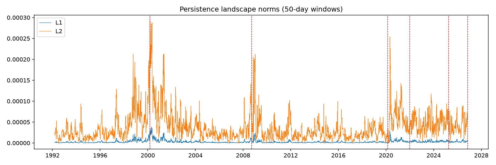
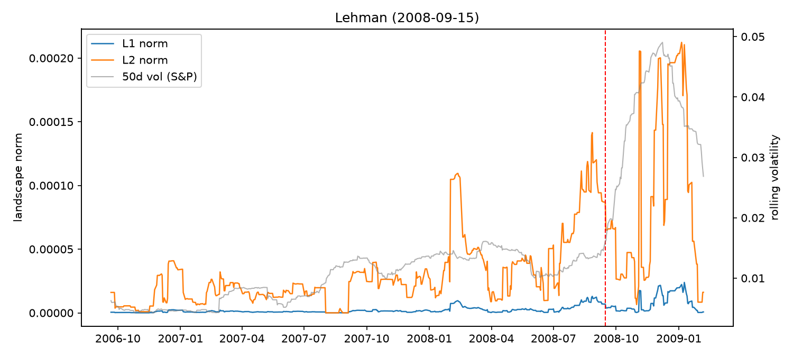
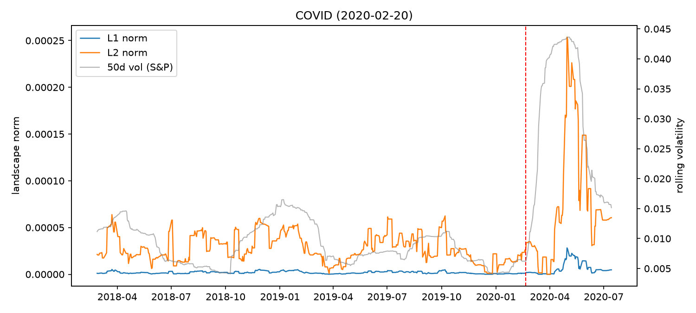
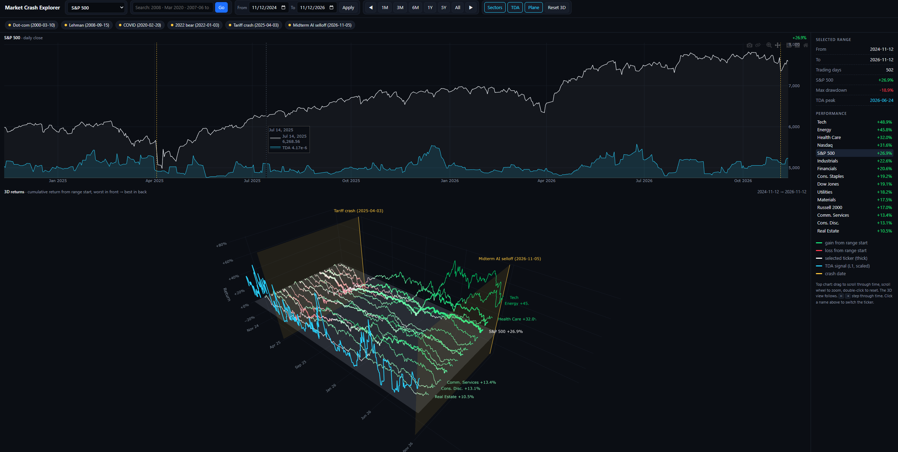

# Can Topology See Market Crashes Coming?

Replication and out-of-sample test of Gidea & Katz (2018), *Topological Data Analysis of Financial Time Series: Landscapes of Crashes* ([arXiv:1703.04385](https://arxiv.org/abs/1703.04385)), using persistent homology on 34 years of US index returns.

**Full write-up: [WRITEUP.md](WRITEUP.md)**



## Results

- **Replicated:** the topological signal rose sharply before the dot-com crash (2.8x normal) and the Lehman collapse (6.0x normal), the two crashes in the original paper.
- **Didn't generalize:** no warning before COVID (2020), the 2022 bear market, the tariff crash (2025), or the midterm AI selloff (2026). The signal only spiked after those crashes started.
- **Not just volatility:** volatility explains only 15% of the signal (R² = 0.15).
- **Too many false alarms:** the paper's trend test fires on 15% of all dates.

**Takeaway:** TDA picks up real structure that volatility misses, and it works for slow-building crashes like bubbles and credit crises. It doesn't catch sudden outside shocks, so it isn't a reliable crash predictor on its own.

| Crash | L1 in the 60 days before vs normal |
|---|---|
| Dot-com, Mar 2000 | **2.8x** |
| Lehman, Sep 2008 | **6.0x** |
| COVID, Feb 2020 | 0.3x |
| 2022 bear, Jan 2022 | 0.6x |
| Tariff crash, Apr 2025 | 1.5x |
| Midterm AI selloff, Nov 2026 | 1.1x |

<p>


</p>

## How it works

1. Daily log returns for the S&P 500, Dow, Nasdaq, and Russell 2000
2. A 50-day sliding window, so each window is a cloud of 50 points in R⁴
3. Vietoris-Rips persistent homology (H₁, loops) on every window
4. Persistence landscapes and their L1/L2 norms, giving one number per day
5. Comparison with 50-day rolling volatility around six crashes

## Run it

```bash
pip install -r requirements.txt
python tda_crashes.py      # pipeline + plots in output/
python analysis.py         # numbers used in the write-up
python visualize_3d.py     # interactive market explorer in your browser
```

The first run downloads the data from Yahoo Finance and caches it in `prices.csv` (indices) and `sectors.csv` (sector ETFs).

## Files

| File | What it does |
|---|---|
| `tda_crashes.py` | Data, persistent homology, landscapes, norms, crash plots, volatility regression |
| `analysis.py` | Pre-crash ratios, Kendall τ trend test, false-alarm rate, lead-lag |
| `visualize_3d.py` | Interactive explorer: price chart on top, synced 3D return lines below, TDA signal, date search |
| `WRITEUP.md` | Full write-up |
| `figures/` | Plots used in the write-up |

## Market explorer
   
`visualize_3d.py` builds `output/market_explorer.html`, which works offline:

- **Top:** price chart for any of the 4 indices or 11 sector ETFs, with the TDA signal in cyan and crash dates in gold. Drag to scroll through time, use the scroll wheel to zoom.
- **Bottom:** a 3D view synced to the top chart. Each line is cumulative return from the start of the visible range (green for gain, red for loss), with a TDA signal line, crash curtains, and a 0% plane.
- **Navigation:** search box (`2008`, `Mar 2020`, `2007-06 to 2009-03`), date pickers, 1M to All, arrow keys, and one-click crash buttons.

## Settings

These are at the top of `tda_crashes.py`: `WINDOW`, `N_LAYERS`, `VOL_WINDOW`, and the `CRASHES` dates.

## Reference

Gidea, M. & Katz, Y. (2018). Topological data analysis of financial time series: Landscapes of crashes. *Physica A*, 491, 820-834.
