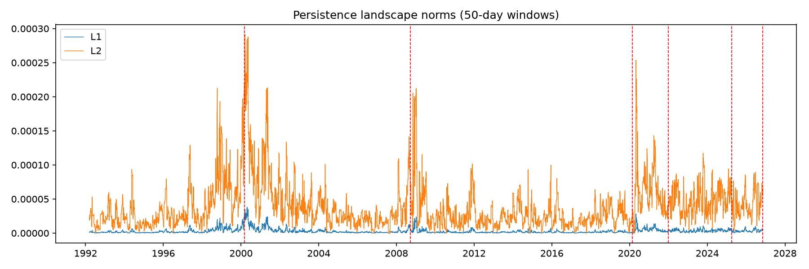
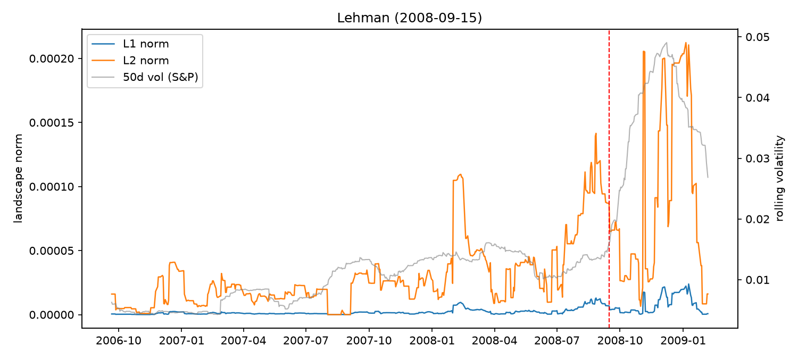
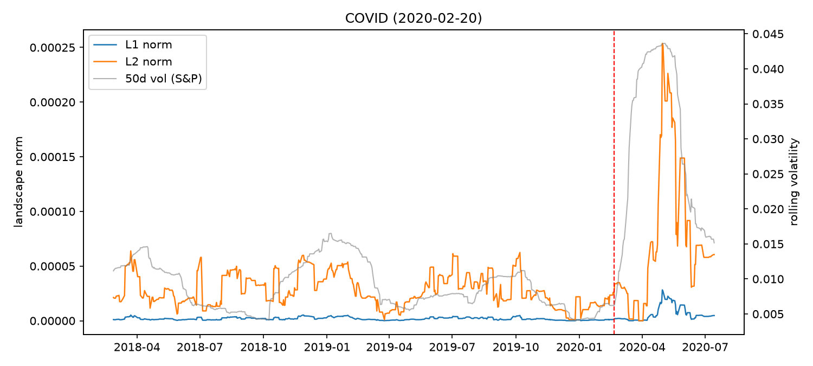

# Can Topology See Market Crashes Coming?

*M Mujtaba Shakeel · November 2026*

## The question

In 2018, Gidea and Katz published a paper claiming that topological data analysis (TDA) picks up early warning signs before stock market crashes. They looked at two crashes, the dot-com crash in 2000 and the Lehman collapse in 2008, and found that a topological measure of the market started rising months before each one.

I wanted to check two things:

1. Does their result replicate?
2. Does it hold up on crashes they never tested, and is it actually telling us something that plain volatility doesn't?

The second question matters because when markets get stressed, returns get more spread out, and spread-out data naturally has more "loops" in it. So the topology signal might just be volatility under a different name.

## Method

- **Data:** daily log returns of the S&P 500, Dow, Nasdaq, and Russell 2000, 1992 to November 2026.
- **Point clouds:** I slide a 50-day window across the data. Each day is a point in 4D (one coordinate per index), so each window is a cloud of 50 points.
- **Persistent homology:** for each window I build a Vietoris-Rips filtration and record the 1-dimensional holes (loops), meaning when each one appears and when it fills in.
- **Persistence landscapes:** I turn each persistence diagram into a landscape function and take its L1 and L2 norms, which gives one number per day. A bigger norm means more, and longer-lasting, loop structure.
- **Comparison:** I compare that signal with 50-day rolling volatility of the S&P 500. I test it on the paper's two crashes, plus four that came after it: COVID (Feb 2020), the 2022 bear market, the tariff crash (Apr 2025), and the midterm AI selloff (Nov 2026).

All the code is in this repo. `tda_crashes.py` runs the pipeline and `analysis.py` gives the numbers below.

## Results

### 1. The signal is mostly not volatility

| | |
|---|---|
| Correlation (L1, volatility) | 0.39 |
| R² | **0.15** |

Volatility explains only about 15% of the variation in the TDA signal, so most of what it's measuring is something else.

### 2. It replicated for the original two crashes, and missed all four new ones

L1 norm in the 60 days before each crash, compared with its median over the two years before that:

| Crash | Type | L1 before crash vs normal |
|---|---|---|
| Dot-com, Mar 2000 | slow build (bubble) | **2.8x** |
| Lehman, Sep 2008 | slow build (credit crisis) | **6.0x** |
| COVID, Feb 2020 | sudden shock | 0.3x |
| 2022 bear, Jan 2022 | rate hikes | 0.6x |
| Tariff crash, Apr 2025 | sudden shock | 1.5x |
| Midterm AI selloff, Nov 2026 | sudden shock | 1.1x |

Before 2000 and 2008, the norms climbed while volatility was still fairly calm, which is the same pattern the paper found. Before COVID, the tariffs, and the midterm selloff, there was basically nothing, and the signal only spiked after the crash had already started.

### 3. As an alarm, it fires too often

The paper's actual early-warning test looks at whether the variance of the norm trends upward over the 250 trading days before a crash (Kendall's τ). Ranking each crash against every other date in the data:

- Lehman: τ = 0.68, 90th percentile. A real signal.
- Dot-com: τ = -0.19, 43rd percentile. Nothing special by this test, even though the level was clearly elevated.
- The other four: between the 7th and 77th percentile.

And τ > 0.6 happens on **15% of all dates**, so an alarm set at that level would go off constantly with no crash following.

### 4. It doesn't lead volatility

The correlation between the TDA signal and volatility is highest when volatility is shifted 20 days *earlier* (0.40), slightly above same-day (0.39). So the signal moves with volatility or a bit behind it, not ahead.

## What I think is going on

The two crashes where it worked were **slow-building, internal** crashes. In the late 1990s, the Nasdaq pulled away from the rest of the market during the tech bubble, and in 2007-08 the credit crisis built up for more than a year before Lehman. In both cases, the way the four indices moved together changed for months beforehand, and that kind of change in structure is exactly what persistent homology is good at picking up.

COVID, the tariffs, and the midterm selloff were **sudden outside shocks**. There was no internal buildup to see, so the topology reacts at the same time as everything else.

## Conclusion

TDA measures real structure in the market that volatility doesn't capture, and it did flag the two slow-building crashes from the original paper. But it gave no warning before any of the four sudden crashes since then, and its trend test has a high false-alarm rate. It could be useful as one input among several for spotting a fragile market. It isn't a reliable crash predictor on its own.

## Limitations

- Six crashes is a small sample, so none of this is statistically conclusive.
- The 60-day "before" window and the crash dates were picked by me, after the fact.
- I only used 4 US indices, which is a small point cloud. More assets (sectors, international markets, rates) might give a richer signal.
- I compared against volatility only. Other standard indicators (VIX, credit spreads, correlation measures) would be a tougher benchmark.

## Next steps

- Use sector ETFs or international indices as the point cloud and see whether the 2020 and 2025 crashes become visible.
- Test against VIX and average pairwise correlation, not just volatility.
- Do a proper out-of-sample test: pick a threshold on 1992-2015 data, then count hits and false alarms on 2016-2026.

## Reference

Gidea, M. & Katz, Y. (2018). Topological data analysis of financial time series: Landscapes of crashes. *Physica A*, 491, 820-834. [arXiv:1703.04385](https://arxiv.org/abs/1703.04385)
